<!-- ================= HEADER: MASTER DESIGN SYSTEM ================= -->

  

  

<!-- ================= ANIMATED DEV FOCUS ================= -->

  

<!-- ================= TERMINAL ASCII TYPING WORDMARK ================= -->

  

  <b>BCA @ IEM '28 &nbsp;•&nbsp; Full Stack Developer &nbsp;•&nbsp; Always Learning</b> 
  <i>Hi, I’m Subhradeep Roy Chowdhury — passionate about building modern, responsive, and user-centric web applications. Driven by turning ideas into impactful solutions through clean, creative code.</i>

 

<!-- ================= FEATURED PROJECTS: CONSTELLATION & LAUNCH SEQUENCE ================= -->

## Built, shipped, shared

  

  

 

<!-- ================= TOOLS & TECHNOLOGIES ================= -->

## Tools & Technologies

  
  
  
  
  
  
  
  
  
  
  
  
  
  
  
  
  
  
  
  
  
  
  

 

<!-- ================= DEVELOPMENT JOURNEY & UPTIME ================= -->

## Uptime in motion

  

  

<!-- Pacman Live Contribution Timeline -->

  <picture>
    <source media="(prefers-color-scheme: dark)" 
            srcset="https://raw.githubusercontent.com/subhradeep333/subhradeep333/output/pacman-contribution-graph-dark.svg">
    <source media="(prefers-color-scheme: light)" 
            srcset="https://raw.githubusercontent.com/subhradeep333/subhradeep333/output/pacman-contribution-graph.svg">
    
  </picture>

 

<!-- ================= BEYOND CODE ================= -->

## Beyond Code

- 💡 I enjoy building quirky, experimental projects that begin as random ideas and turn into valuable learning experiences.
- ⚡ I consider myself **productively lazy** — always looking for smarter ways to automate, simplify, and optimize workflows.
- 🎮 Outside development, I enjoy gaming and experimenting with new tech.

 

<!-- ================= FOOTER / KEEP IT MOVING ================= -->

## Keep it moving

  

  
  &nbsp;
  
  &nbsp;
  
  &nbsp;
  

